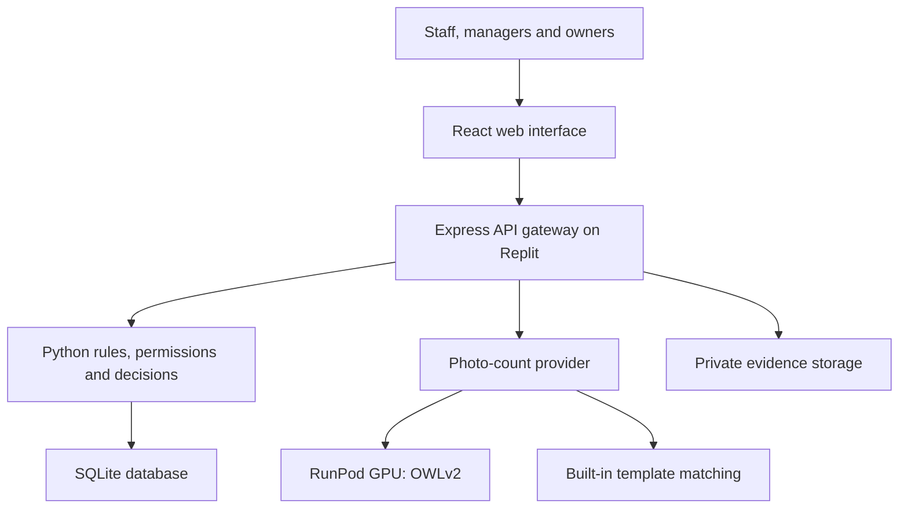

# Veracity

**Understand the difference before changing the number.**

Veracity helps SME retailers locate stock, verify physical quantities and investigate inventory discrepancies through photo-assisted counting, explainable record checks and human-approved decisions.

**SDC Hackathon 2026 · Team newbies · Domain 2 · SDG 8**

> **Prototype scope:** synthetic inventory data and shared demo roles. Photo counting supports a pretrained model through RunPod, with a built-in template-matching alternative. RFID reader input is simulated. Managers authorize stock corrections; neither image analysis nor a tag read changes inventory automatically.

## Team Information

| Field | Details |
| --- | --- |
| Team Name | newbies |
| Team Domain | Domain 2 |
| SDG Track | SDG 8 — Decent Work and Economic Growth |
| Project / Solution Name | Veracity |
| Team Leader | KOH HUI YUAN |
| University | Tunku Abdul Rahman University of Management and Technology (TAR UMT) |
| Number of Members | 5 |

## Links

| Resource | Link |
| --- | --- |
| GitHub Repository | https://github.com/khyuannn/sdc_veracity_newbies |
| Live Demo | https://sdcveracitynewbies-lowzh51.replit.app/login |
| RunPod Endpoint | `https://api.runpod.ai/v2/6ffcqmfzokm838` |
| Slide Deck | [View slide deck](submission/SDC2026_newbies_SlideDeck.pdf) |
| Demo Video | https://youtu.be/CzHVWAjZkkE |

## Try the Demo — For Judges and Reviewers

Sample inventory records, supporting documents and photos are provided in
[docs/test-data](docs/test-data/) so reviewers can explore the workflow.

### 1. Open Veracity

Visit the [Live Demo](https://sdcveracitynewbies-lowzh51.replit.app/login).

Select **Manager** to import records, **Staff** to count stock, or **Owner**
to review decisions and summaries. These are shared demonstration roles.

### 2. Load the Sample Records

If the sample products are not already present, log in as **Manager** and
open **Inbox → Import records**.

Import these files in order:

| Order | Sample File | Import Type |
| --- | --- | --- |
| 1 | [products.csv](docs/test-data/evidence-pack/csv-records/products.csv) | Inventory products |
| 2 | [movements.csv](docs/test-data/evidence-pack/csv-records/movements.csv) | Unposted stock movements |

Import each file only once. If the records already exist, use the existing
dataset; duplicate IDs are rejected.

The deployed demo is shared. Please do not delete or reset other users'
records. A fresh local instance can be used for a repeatable walkthrough.

### 3. Try Photo-Assisted Counting

Switch to **Staff**, open **Count**, and select the corresponding product.

Example photos:

- [Snack biscuits — 39 packs](docs/test-data/photo-count/snack-biscuits-39.jpg)
- [Coffee example](docs/test-data/photo-count/coffee.jpg)
- [Bottled-water example](docs/test-data/photo-count/spritzer.jpg)

Choose **Count from photo**, upload a sample, and draw a box around
**one item**. Review the detection boxes, correct the suggested quantity
if necessary, and confirm the counting area before selecting **Use this count**.

Detection results may vary. The confirmed quantity is submitted through
the normal discrepancy-assessment workflow.

### 4. Explore Evidence and Manager Decisions

For the prepared evidence investigation, follow the
[step-by-step walkthrough](docs/test-data/evidence-pack/START-HERE.txt).

Supporting PDFs and images are available in
[upload-documents](docs/test-data/evidence-pack/upload-documents/).

The optional [additional-evidence.csv](docs/test-data/evidence-pack/csv-records/additional-evidence.csv)
is a later walkthrough step. Do not import it with the initial dataset.

Upload documents through the case's evidence section, not the CSV importer.
Attachments support human review; uploading them does not automatically
resolve a discrepancy or change stock.

### 5. Explore Crate Tracking and Summary

In **Crates**, register a product-linked crate and use **Simulate RFID scan**
to retrieve its record. Review its location and transfer history, then use
**Check this product’s stock** to return to Count.

RFID input is simulated; no physical reader is required.

Finally, switch to **Manager** or **Owner** and open **Summary** to review
count activity, decisions and outstanding investigations.

## Overview

### Problem

When physical stock differs from inventory records, a small retailer must determine whether the difference comes from unposted movements, conflicting records or stock stored elsewhere. Staff may need to cross-check sales, delivery information and supporting documents before a manager can justify a correction. An unsupported adjustment can hide an unresolved problem and make later review difficult.

### Solution

Veracity connects five activities in one workflow:

**Locate → Count → Explain → Decide → Trace**

1. **Locate:** identify a registered crate and review its last recorded location and transfer history.
2. **Count:** use a photo-assisted quantity suggestion or enter a manual total; staff verify the result.
3. **Explain:** compare the confirmed count with recorded stock and eligible unposted movements.
4. **Decide:** a manager approves a supported correction, rejects it, requests review or explicitly overrides with a reason.
5. **Trace:** retain assessment versions, supporting evidence, decisions and outcomes in History and Decision Passports.

The model-based AI component is photo counting with pretrained **OWLv2** on RunPod. Stock calculations and correction permissions use deterministic rules. The built-in counter uses template matching rather than a trained model.

### Value for SMEs and SDG 8

The intended benefits are less repetitive checking, more consistent investigations and clearer accountability for stock corrections. This supports the SDG 8 focus on productive work and technological improvement. Real-world time savings, financial savings and accuracy improvements require user evaluation; they are not established by this prototype.

## Key Features

| Feature | What it does |
| --- | --- |
| **Photo-assisted counting** | Upload a photo, mark one example item, review detection boxes and confirm the physical quantity. Manual entry remains available. |
| **Explainable discrepancy assessment** | Check the selected product's eligible unposted movements at or before the count time, show the calculation and flag supported, incomplete or conflicting evidence. |
| **Human-controlled corrections** | Managers review cases and record a reason for their decision. Normal approval requires supported, nonconflicting evidence. |
| **Decision Passports** | Preserve the assessment, evidence references, decision-maker, reason and outcome for later review. |
| **Evidence attachments** | Accept validated JPG, PNG and PDF documents for authorized human review, including historical assessment context. |
| **Crate and location tracking** | Register a crate identifier, link it to a product, review recorded placement and confirm whole-crate transfers. |
| **Simulated RFID reader** | Demonstrate tag lookup, scan history, unknown-tag handling and location-review alerts without physical hardware. |
| **Product location reminders** | Show a product's registered crate locations on Count so staff can check the complete relevant scope. |
| **CSV imports** | Managers import products first, then stock movement records. Imports add records; they do not overwrite existing stock. |
| **Inventory Summary** | Managers and owners review count activity, decisions and outstanding investigations by day, week, month or year. |

### The assessment calculation

```text
Expected stock = recorded stock + net eligible unposted movements
```

For example: recorded stock is **50**, the verified count is **43**, and eligible unposted sales total **−7**. Expected stock is **43**. Those records explain the difference only if the evidence is also complete and nonconflicting.

**Assessment alone never changes stock.** Uploading an attachment does not automatically prove a quantity or resolve a conflict. A normal approval posts the assessed eligible movements once; an explicit override records a separate correction without silently treating uncertain records as resolved.

### Demo roles

| Role | Responsibilities |
| --- | --- |
| **Staff** | Submit counts, provide evidence, work on their cases and record crate activity. |
| **Manager** | Import records, review cases, decide corrections, manage operational crate activity and view Summary. |
| **Owner** | Review decisions, history and Summary with read-only operational access. |

The login role picker selects shared demonstration identities. It is not personal account registration or production authentication. Saved records on the deployed application may be visible to other demo users according to their selected role.

## Tech Stack

| Layer | Technology |
| --- | --- |
| Frontend | React, TypeScript, Vite and Tailwind CSS |
| API Gateway | Node.js and Express |
| Core Backend | Python 3.10+ standard library and SQLite integration |
| Database | SQLite for products, movements, counts, cases, crate events and audit records |
| AI / GPU Compute | RunPod Serverless with pretrained OWLv2 (`google/owlv2-base-patch16-ensemble`) |
| Local Image Processing | Node.js with `sharp`; normalized template matching when RunPod is not configured |
| Evidence Storage | Replit private App Storage in the hosted setup; explicit local disk storage in development |
| Hosting / Dev | Replit hosting and cross-platform local VS Code launchers |
| API Contracts | OpenAPI with generated client/types and validation bindings |
| Testing | Python `unittest`, Node tests and Playwright |
| Collaboration | Git and GitHub |

No custom model training, text-generation GenAI API or RAG pipeline is required for the implemented workflow.

## Project Structure

The paths below reflect this repository. There is no root-level `src/main.py` or application-wide `requirements.txt`.

| Path | Responsibility |
| --- | --- |
| `artifacts/veracity/src/components/screens/` | Frontend pages, including Count, Crates, cases, History and Summary |
| `artifacts/veracity/src/components/veracity/` | Shared workflows, photo-count dialog, product-location panel and evidence controls |
| `artifacts/veracity/src/components/reports/` | Summary period selection, charts, decisions and follow-ups |
| `artifacts/veracity/src/components/ui/` | Shared UI primitives |
| `artifacts/veracity/src/hooks/`, `artifacts/veracity/src/lib/` | Frontend state, requests, stock types and Malaysia date formatting |
| `artifacts/veracity/public/` | Public assets |
| `artifacts/api-server/src/` | Express gateway, vision integration and evidence-file service |
| `artifacts/api-server/backend/` | Python/SQLite inventory, assessments, permissions, reports and crate tracking |
| `artifacts/api-server/backend/reporting/` | Reporting calendar boundaries, aggregation and snapshots |
| `artifacts/api-server/detector/` | RunPod worker, OWLv2 detector, Dockerfile and Python worker requirements |
| `lib/api-spec/` | OpenAPI source contract |
| `lib/api-client-react/`, `lib/api-zod/` | Generated API client/types and validation bindings; do not edit generated files by hand |
| `local-dev/` | Cross-platform startup, local gateway and native-dependency preparation |
| `scripts/` | Setup and post-merge utilities |
| `tests/` | Browser tests using isolated temporary data |
| `docs/` | Workflow, photo-count, evidence and validation documentation |
| `docs/test-data/` | Synthetic CSVs, evidence walkthrough and photo-count fixture |
| `artifacts/mockup-sandbox/` | Separate preview tooling; not the product frontend |
| `.env.example` | Environment-variable names and guidance |
| `.replit` | Replit Project workflow and deployment configuration |
| `LICENSE` | Apache License 2.0 |

### Submission documents to add

The following is the required submission layout to prepare; these files must be added and checked before the corresponding checklist items are complete.

| Planned file | Purpose |
| --- | --- |
| `submission/SDC2026_newbies_Preliminary.pdf` | Preliminary proposal |
| `submission/SDC2026_newbies_TechDeclaration.pdf` | Technology declaration |
| `submission/SDC2026_newbies_Replit_POU.pdf` | Replit proof of use |
| `submission/SDC2026_newbies_Runpod_POU.pdf` | RunPod proof of use |
| `submission/SDC2026_newbies_SlideDeck.pdf` | Pitch deck |

## Architecture



The gateway uses **RunPod when both RunPod settings are configured**; otherwise it uses the built-in counter. It does not silently switch to the built-in provider after a configured RunPod request fails. Suggested quantities return to staff for verification and are then submitted through the normal count workflow.

Crate observations and transfers are stored separately from quantity-reconciliation movements. A crate tag identifies its record; it does not measure its contents or establish a transfer direction.

## How to Run

### Option 1 — Run on Replit

1. Open the team's Replit project or import the GitHub repository into a Replit project.
2. Install dependencies from the repository root:

   ```bash
   pnpm install --frozen-lockfile
   ```

3. Configure the necessary environment values in **Replit Secrets**, using `.env.example` as the reference.
4. Select the existing **Project** workflow and click **Run**. `.replit` starts the frontend and API workflows; Express starts the private Python backend automatically.
5. Publish or republish through the project's deployment setup when sharing the hosted version. Keep deployment settings and secrets consistent with the working project.

| Variable | Purpose |
| --- | --- |
| `RUNPOD_API_KEY` | Server-side RunPod credential; required for the remote photo-count provider |
| `RUNPOD_ENDPOINT_ID` | Endpoint identifier; required alongside the API key for RunPod counting |
| `PRIVATE_OBJECT_DIR` | Private evidence-storage configuration for the hosted evidence service |
| `VERACITY_DB` | Optional explicit SQLite database path |
| `APP_ORIGIN` | Optional exact trusted browser origin configuration |

The hosted evidence service needs its existing Replit private App Storage configuration. Missing cloud settings produce an error; they do not enable local storage automatically. Configuring the two RunPod values selects the remote photo provider. Omitting them uses the built-in counter.

**Do not put API keys in frontend code, `VITE_` variables, the README or Git.**

### Option 2 — Run Locally

#### Requirements

- Node.js 24 and npm.
- pnpm 10, following the existing project setup.
- Python 3.10+ with the standard SQLite module.

Install pnpm if needed:

```bash
npm install --global pnpm@10
```

Clone and start:

```bash
git clone https://github.com/khyuannn/sdc_veracity_newbies.git
cd sdc_veracity_newbies
pnpm install --frozen-lockfile
pnpm local
```

Wait for the API's **Server listening** message, then open **http://localhost:3000**.

No Python virtual environment or root-level `pip install -r requirements.txt` is needed for the core local app. The separate GPU worker has its own container and dependencies.

**Optional local RunPod settings:** create a Git-ignored `.env.local` at the repository root, or set the two variables in your terminal. The local backend launcher loads `.env.local`; a generic `.env` file is not the documented loader for this launcher.

```dotenv
RUNPOD_API_KEY=replace_with_your_private_key
RUNPOD_ENDPOINT_ID=replace_with_your_endpoint_id
```

Never commit that file or real values. No RunPod credentials are needed to use the built-in counter.

#### Separate frontend and backend terminals

```bash
# Terminal 1: from the repository root
pnpm local:backend

# Terminal 2: from the repository root
pnpm local:frontend
```

Use either the single-command launcher or the two-terminal approach, not both simultaneously. Always browse port **3000**, not the internal Vite address. The gateway routes `/api` to Express and frontend requests to Vite.

Express starts the Python subprocess. Do not separately run `python server.py` for the full application. Stop with **Ctrl+C**; restart the backend after backend source changes. In VS Code, **Terminal → Run Build Task** also starts the configured local workflow.

#### Import demo records

1. Log in as **Manager**.
2. Open **Inbox → Import records**.
3. Select inventory products and import `docs/test-data/evidence-pack/csv-records/products.csv`.
4. Select unposted stock movements and import `docs/test-data/evidence-pack/csv-records/movements.csv`.
5. Switch to Staff to submit counts and evidence.

Import products before movements, because movement records reference existing product IDs. Import each prepared record once; duplicate IDs are rejected. Additional walkthrough instructions are in [DEMO_IMPORT_GUIDE.md](docs/DEMO_IMPORT_GUIDE.md) and the [evidence pack](docs/test-data/evidence-pack/README.md).

### Local data and uploaded evidence

| Local path | Contents |
| --- | --- |
| `.veracity-local/veracity.sqlite3` | Local inventory, cases, sessions, crate history, reporting data and attachment metadata |
| `.veracity-local/evidence/evidence-staging/` | Pending upload bytes |
| `.veracity-local/evidence/case-evidence/` | Preserved validated attachment bytes |

The local launcher explicitly enables development-only disk storage. It starts an empty local database when none exists, without deleting or copying another database. Restarting preserves its records. Local file mode is rejected outside development.

**Git does not synchronize database records or uploaded evidence.** Localhost data is separate from the deployed application's data. A hosted demo may expose shared records to other users according to their chosen demo role.

JPG, PNG and PDF evidence must be valid, nonempty and at most 10 MiB. Photo-count images are processed for the count suggestion and are not automatically saved as evidence; attach the photo separately if it needs to be preserved with a case.

### Demo workflow

1. **Locate:** register a crate, generate a demo identifier and simulate a read.
2. **Review location:** inspect its last recorded place, scan activity and transfer journey.
3. **Count:** open the linked product, upload a photo and mark exactly one example item.
4. **Verify:** inspect detections, adjust the quantity if needed and confirm the full counting scope.
5. **Investigate:** submit the count, inspect eligible movements and attach supporting evidence.
6. **Decide:** a manager reviews the explanation and records the decision and reason.
7. **Trace:** view History, Decision Passports and Summary.

A product-level count must include all relevant crates/locations. A photo of one shelf section must not be presented as the entire shop's quantity.

## Run Tests

From the repository root:

```bash
# Python backend and Node tests, including photo-count fixtures
pnpm test

# Workspace TypeScript checks
pnpm run typecheck

# Frontend evidence-upload tests
node --test artifacts/veracity/tests/evidence-upload.test.mjs

# Browser setup and isolated end-to-end tests
pnpm exec playwright install chromium
pnpm test:e2e
```

For Python backend tests alone:

```bash
python -m unittest discover -s artifacts/api-server/backend -p "test_*.py" -v
```

Use `python3` if that is your platform's Python command.

Browser tests start a dedicated loopback-only gateway, temporary SQLite database and local evidence directory. They refuse an external `PLAYWRIGHT_BASE_URL`; do not bypass isolation or run write tests against the public demo. The test fixture checks that the demonstration database remains unchanged. In the current isolated browser setup, photo tests use the built-in counter rather than paid external inference.

Earlier merge validation passed **74 Python tests, 17 Node tests and three targeted browser tests**, plus TypeScript checks and frontend/API builds. These are results for that tested revision, not a guarantee about later commits or real-world detection accuracy. Actual Windows and Android hardware behaviour must be verified on those devices.

## How We Use Replit — Required

- **Hosting:** the published prototype is shared through the Live Demo link above.
- **Application runtime:** the Project workflow starts the React/Vite frontend and Express gateway; the gateway starts the private Python service.
- **Secrets:** the remote inference API key and endpoint ID belong in Replit Secrets.
- **Evidence files:** the hosted setup uses private App Storage with application-level case authorization and metadata in SQLite.
- **Development:** the repository includes Replit workflows and configuration alongside local VS Code launchers. Shared Multiplayer development is not asserted as a completed activity.

**Proof of use to add:** `submission/SDC2026_newbies_Replit_POU.pdf`.

Evidence-file storage and SQLite database storage are separate. App Storage configuration alone does not guarantee durable SQLite persistence across deployment lifecycle events; persistent database deployment and backup arrangements must be verified before operational use.

## How We Use RunPod — Required

- **GPU workload:** the configured Serverless worker performs photo-based object detection with pretrained OWLv2.
- **Handler:** `artifacts/api-server/detector/runpod_handler.py`.
- **Model:** `google/owlv2-base-patch16-ensemble`; no team-specific training is required.
- **Inputs:** a base64 JPG/PNG, one example box in image pixels and the selected product label.
- **Outputs:** suggested count, detection boxes, image dimensions and model information.
- **Integration:** `artifacts/api-server/src/lib/runpod-count.ts` submits a job to `/runsync` and polls its status when necessary.
- **Earlier CPU usage:** RunPod CPU compute was also used to execute the backend test suite; this is distinct from GPU inference.

**Proof of use to add:** `submission/SDC2026_newbies_Runpod_POU.pdf`.

### Worker deployment

Use the existing detector Dockerfile with:

| Setting | Value |
| --- | --- |
| Dockerfile | `artifacts/api-server/detector/Dockerfile` |
| Build context | `artifacts/api-server/detector` |
| Runtime | RunPod Serverless GPU worker |
| Entry point | `python -u runpod_handler.py` |

The container installs its own Python dependencies and pretrained model. Deploy the worker, then set the resulting endpoint ID and API key in the application backend environment. Consult [PHOTO_COUNT.md](docs/PHOTO_COUNT.md) for the project's worker setup. Verify provider pricing and endpoint availability in your own RunPod account.

### Example request

Illustrative Bash request; replace the image placeholder with base64-encoded JPG/PNG bytes and use an example box appropriate to that image. Credentials must already be set privately in the terminal environment.

```bash
curl -X POST "https://api.runpod.ai/v2/${RUNPOD_ENDPOINT_ID}/runsync" \
  -H "Authorization: Bearer ${RUNPOD_API_KEY}" \
  -H "Content-Type: application/json" \
  -d '{"input":{"image":"<BASE64_JPG_OR_PNG>","exemplar":{"x":65,"y":120,"width":167,"height":145},"label":"Snack Biscuits B"}}'
```

The response may initially report a queued/in-progress job. The application's connector handles polling. Staff still review the final count; a detection score is not a guarantee of total-count accuracy.

## Inventory Summary

Managers and owners can select Daily, Weekly, Monthly or Yearly views and choose a date. Daily activity is grouped by hour, weekly/monthly by day, and yearly by month. Calendar boundaries use **Asia/Kuala_Lumpur**, with Monday–Sunday weeks.

- Count submissions include matching counts.
- Products counted are deduplicated within the selected reporting period.
- New cases use creation time; closed cases use decision time.
- Outstanding investigations can include unresolved cases from earlier periods.
- Current-period views refresh while visible.
- Historical reports are saved on their **first view**, not automatically at midnight or period end.
- Existing saved weekly reports are retained, and case links open the current case.

These are in-app operational reports, not scheduled emails, proof of financial savings or automatic detection of theft.

## Challenges & Learnings

| Challenge | Approach and learning |
| --- | --- |
| Counting from imperfect photos | Provide visible detection boxes, example selection, corrections and a counting-area confirmation. Human verification remains necessary. |
| Explaining a discrepancy consistently | Keep quantities and eligibility checks in deterministic backend rules, separate from the vision model. |
| Preventing unsupported or repeated corrections | Validate roles, current evidence/stock revisions and transactional decision posting. |
| Making evidence traceable | Preserve attachment references, assessment versions and decision history; documents remain inputs for human review. |
| Combining teammate changes | Use Git history and merge focused changes so photo counting and crate tracking coexist. |
| Keeping test data separate from the walkthrough | Use disposable browser-test databases and evidence storage rather than mutating the public demo. |
| Connecting physical concepts without hardware | Demonstrate the RFID workflow with explicit simulated input and distinguish observations from confirmed transfers. |

The main design lesson is that an automated suggestion should not be confused with verified evidence or authorization to change stock.

## Future Improvements

- [ ] Integrate and test a compatible physical RFID reader and Android connection.
- [ ] Evaluate vision accuracy on additional unseen photos, product types, lighting and occlusion conditions.
- [ ] Validate review-time savings through equivalent manual-versus-Veracity tasks with SME users.
- [ ] Add real user accounts, business/tenant separation and appropriate authorization for operational use.
- [ ] Verify durable shared database deployment, backups and recovery.
- [ ] Support crate/location quantity balances and partial movements with explicit rules before using them in reconciliation.
- [ ] Explore live POS/ERP or Orbyte integration; the current workflow uses imported records.

## Team

The roles below summarize visible repository contributions and the project work described by the team; they are not a measurement of individual effort. Confirm each member-to-account mapping and final responsibility with the team before submission. Commits authored by Replit Agent do not identify which person initiated the work.

| Name | Contribution-based Role | GitHub |
| --- | --- | --- |
| **KOH HUI YUAN** | Team Lead; product direction, crate-tracking integration, UI improvements and pitch coordination | [@khyuannn](https://github.com/khyuannn) |
| **Chew Zhi Foong** | Evidence-upload/backend integration and local-development merge support | [@Zhifoong0822](https://github.com/Zhifoong0822) |
| **Derrick Lee Jia Qian** | Frontend count-entry workflow and quantity-input improvements | [@Derrick-L16](https://github.com/Derrick-L16) |
| **Low Zhan Hui** | Full-stack integration; photo counting, RunPod worker, reporting and development setup | [@Lowzh5](https://github.com/Lowzh5) |
| **Jong Zhe Nyat** | Frontend count/import workflow, CSV-import feedback and integration support | [@dylanjong-dev](https://github.com/dylanjong-dev) |

Contribution context: [repository commit history](https://github.com/khyuannn/sdc_veracity_newbies/commits/main/). Shared and AI-assisted development means commit counts alone do not represent the full contribution of each member.

## Troubleshooting

| Symptom | What to check |
| --- | --- |
| `pnpm` not found | Install the project's pnpm version and reopen the terminal. |
| Missing dependencies | Run `pnpm install --frozen-lockfile` at the repository root. |
| Python not found | Install Python 3.10+ and reopen VS Code. The launcher checks Windows `python`, `py -3`, then `python3`. |
| Port already in use | Stop old processes; do not run both startup styles simultaneously. |
| Login/API unavailable or API returns HTML | Start both services with `pnpm local`, wait for the API and browse port 3000. |
| Empty local inventory | Import product records in Inbox first, then stock movement records. |
| Duplicate ID / missing product import error | Check the import order, product references and duplicate IDs; an import is not an overwrite. |
| Photo provider shows built-in | Both RunPod settings must be present in the backend environment to select RunPod. Restart after changing local settings. |
| RunPod request fails | Verify endpoint ID, API key, worker logs and availability. Do not assume a failed remote request switched to local counting. |
| Evidence upload fails on Replit | Check private App Storage settings and case permissions. |
| Upload rejected on a closed case | Upload to an authorized open case and its latest assessment. |
| Playwright executable missing | Run `pnpm exec playwright install chromium`. |
| Crate quantity looks unchanged after a sale | It is the quantity declared at registration, not a live remaining balance. |

Optional local terminal settings: `LOCAL_WEB_PORT` (3000), `LOCAL_API_PORT` (8000), `LOCAL_VITE_PORT` (5173), `LOCAL_DATA_DIR` and `PYTHON_EXECUTABLE`. Keep port settings consistent between separate terminals. Custom data directories must stay outside Git/public assets.

## AI Assistance & Attribution

ChatGPT/Codex assisted with planning, code generation/modification, debugging, testing guidance and documentation. The team remains responsible for reviewing and understanding the submission. Development assistance is distinct from the application's runtime AI, which is the configured computer-vision model.

Third-party frameworks, libraries and pretrained model assets retain their own licenses and attribution requirements. See the [AI use declaration](docs/AI_USE_DECLARATION.md) and the project's technology declaration for the final disclosure.

## License

This project is licensed under the **Apache License 2.0**. See [LICENSE](LICENSE).
